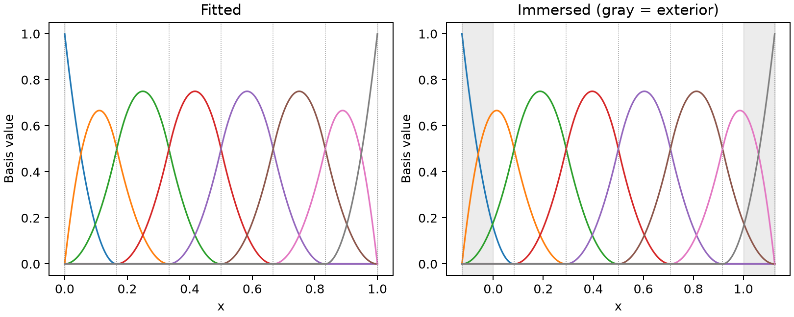
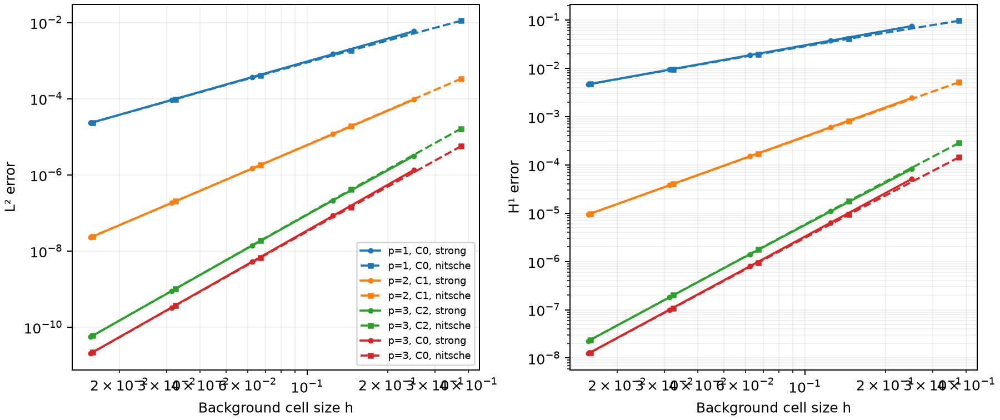
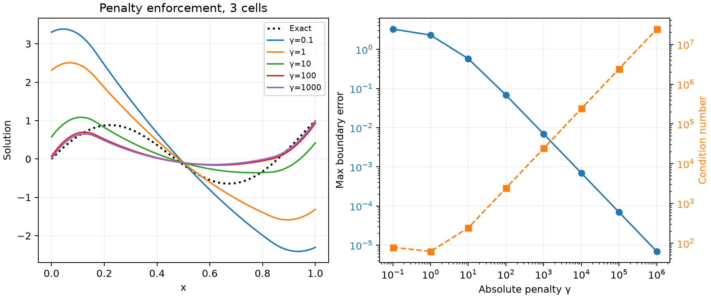
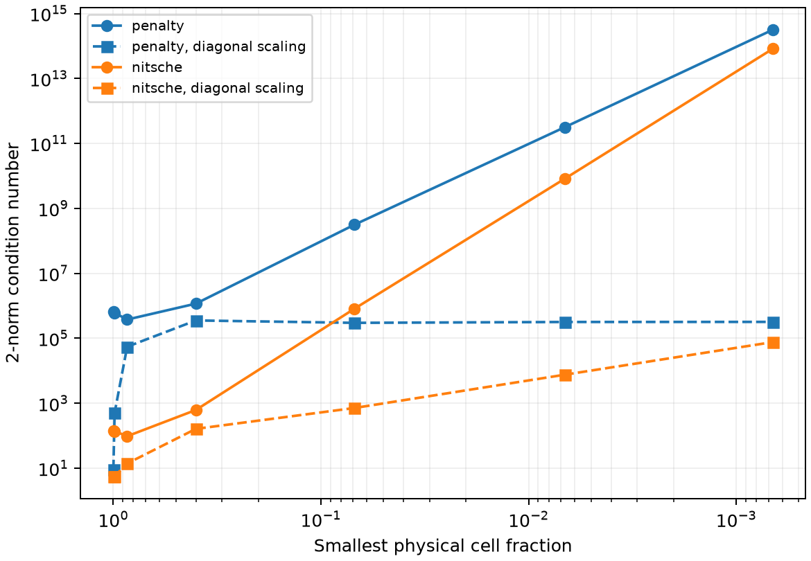

# Immersed B-spline finite element methods

A sparse Python implementation of fitted and immersed B-spline Galerkin discretizations of the one dimensional Poisson equation. The project investigates convergence, weak enforcement of Dirichlet boundary conditions, and ill conditioning caused by small cut cells.

Developed from my MSc Applied Finite Elements coursework at TU Delft (2022), with a new standalone Python implementation, additional numerical verification, and a symmetric Nitsche formulation. The code evaluates B-splines directly on the background mesh instead of using the original MATLAB Bézier extraction and knot insertion helpers.



## Mathematical model

Solve the boundary value problem

$$
-u''(x)=f(x),\qquad x\in(a,b),\qquad u(a)=g_a,\quad u(b)=g_b.
$$

The physical domain is embedded in a uniform background mesh with $m\geq 3$ cells. Following the original assignment, the background domain extends by $\varepsilon=\theta(b-a)/(m-2)$ at each end, where $0\leq\theta<1$. Integration is performed only over the physical intersections of the background cells with $(a,b)$. As $\theta\to1$, the two end cells have vanishing physical measure.

The approximation is $u_h=\sum_i c_i N_i$, where $N_i$ are B-splines of degree $p$ and continuity $C^k$ at interior knots, with $0\leq k<p$. The open knot vector has endpoint multiplicity $p+1$ and interior multiplicity $p-k$. The element integrals use Gauss–Legendre quadrature. Basis values, derivatives and assembled matrices are sparse.

### Boundary conditions

Three alternatives are implemented:

- **Strong enforcement** on fitted meshes: eliminate the first and last coefficients.
- **Penalty enforcement** on either mesh: add $\gamma\sum_{s\in\{a,b\}} u_h(s)v_h(s)$ to the bilinear form and $\gamma\sum_s g_s v_h(s)$ to the load. This approximates Dirichlet data as $\gamma$ increases, but is not consistent at finite $\gamma$.
- **Symmetric Nitsche enforcement** on either mesh: use the consistent bilinear and linear forms

$$
\begin{aligned}
a_h(u,v)&=\int_a^b u'v'\,dx-\sum_s (\partial_n u\,v+\partial_n v\,u)(s)+\sum_s\beta_s u(s)v(s),\\
\ell_h(v)&=\int_a^b fv\,dx-\sum_s g_s\partial_n v(s)+\sum_s\beta_s g_s v(s).
\end{aligned}
$$

Here $\partial_n u(a)=-u'(a)$ and $\partial_n u(b)=u'(b)$. The Nitsche parameter is $\beta_s=\gamma p^2/\ell_s$, where $\ell_s$ is the physical length of the corresponding boundary cell and $\gamma>1$ (default 10). The bound $|v'(s)|^2\leq p^2\|v'\|^2_{L^2(K_s)}/\ell_s$ follows from the endpoint trace inequality for degree-$p-1$ polynomials. This scaling controls the boundary terms on cut cells; it does not remove small support ill conditioning. The two boundary cells are distinct.

## Numerical experiments

### Convergence

The exponential manufactured solution is $u(x)=(e^x-1)/(e-1)$ on $(0,1)$, with $f=-u''$. The tests cover linear, quadratic and cubic B-splines, using fitted strong enforcement and immersed Nitsche enforcement with $\theta=0.5$.



Observed rates between 32 and 64 background cells, using actual background cell size:

| Degree / continuity | Fitted L2 | Fitted H1 | Immersed L2 | Immersed H1 |
| --- | ---: | ---: | ---: | ---: |
| 1 / C0 | 2.00 | 1.00 | 1.99 | 0.99 |
| 2 / C1 | 3.00 | 2.00 | 3.00 | 1.99 |
| 3 / C2 | 3.99 | 2.99 | 4.00 | 2.99 |
| 3 / C0 | 4.00 | 3.00 | 3.99 | 2.99 |

The observed orders are consistent with the expected smooth solution rates $O(h^{p+1})$ in $L^2$ and $O(h^p)$ in $H^1$.

### Penalty parameter

Using $u(x)=\sin(2\pi x+1/3)+x-\sin(1/3)$, the experiment varies the absolute penalty on a coarse fixed immersed mesh. Boundary error decreases as the penalty increases, but the matrix becomes ill conditioned. Interior approximation error need not decrease monotonically as the penalty grows.



For example, increasing $\gamma$ from 10 to 1000 reduces the maximum endpoint error from about 0.578 to 0.00692, while the matrix condition number rises from about 244 to 24,324.

### Small cut cells

On a six cell background mesh, vary $\theta$ from 0.001 to 0.999. Compare a fixed absolute penalty of $10^6$ with symmetric Nitsche enforcement, and compute the condition number before and after symmetric diagonal scaling $D^{-1/2}AD^{-1/2}$, where $D=\mathrm{diag}(A)$.



At $\theta=0.99$, the Nitsche matrix has condition number about $8.24\times10^9$; symmetric diagonal scaling reduces it to $7.59\times10^3$. This is a conditioning diagnostic, not a preconditioned solve or a claim of cut independent conditioning. Very small cut cells can still compromise solution accuracy; the reported extreme condition numbers are floating point estimates.

All plots and the underlying CSV tables are reproducible using the experiment driver.

## Installation and usage

Requires Python 3.10 or newer.

```bash
python -m pip install -e '.[dev]'
python -m pytest
python examples/run_experiments.py
```

Example:

```python
import numpy as np
from immersed_bspline_fem import SplineSpace, uniform_mesh, solve_poisson

mesh = uniform_mesh(elements=16, theta=0.5)
space = SplineSpace(mesh, degree=2, continuity=1)
solution = solve_poisson(
    space, lambda x: -np.exp(x) / np.expm1(1),
    boundary=(0, 1), method="nitsche",
)
l2, h1 = solution.errors(
    lambda x: np.expm1(x) / np.expm1(1),
    lambda x: np.exp(x) / np.expm1(1),
)
print(l2, h1)
```

## Verification

The test suite checks partition of unity, derivative consistency with SciPy, physical quadrature and cut geometry, exact reproduction of a quadratic polynomial, sparse symmetric positive definite matrices in representative cases, nonhomogeneous penalty boundary conditions, convergence rates, ill conditioning and input validation. GitHub Actions is configured for Python 3.10 and 3.12.

## Project layout

```text
src/immersed_bspline_fem/  # Mesh, spline space, quadrature, assembly and solver
examples/                 # Reproducible numerical experiments
tests/                    # Numerical verification
results/                  # Generated figures and numerical CSV tables
.github/workflows/        # Continuous integration
```

## Scope

This is a one-dimensional research and educational implementation. Dense condition-number estimates are intended for small systems only. A natural extension is a two-dimensional immersed Poisson solver with curved boundaries and additional stabilization.
